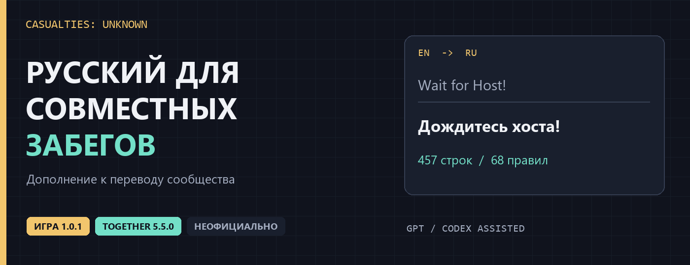
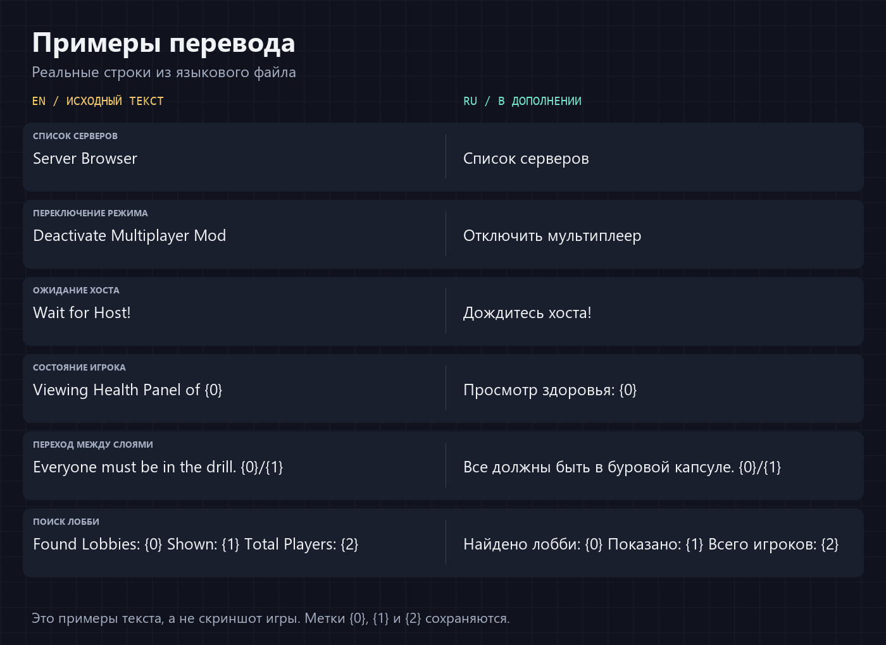

# Casualties: Unknown — русский перевод 1.0.1 + Together

Неофициальное дополнение к русскому переводу сообщества для **полной версии Casualties: Unknown 1.0.1** и установленного мода **Casualties: Together 5.5.0**.

Я не нашёл обновлённого русского перевода под новую версию игры, поэтому подготовил это дополнение с помощью GPT / Codex. Оно рассчитано на **Casualties: Unknown 1.0.1** и **Casualties: Together 5.5.0**. За основу взят перевод сообщества — его авторы указаны ниже.

**[Скачать перевод](ru-RU.json?raw=true)** · **[Примеры](#примеры-перевода)** · **[Установка](#установка)**

## Скачать

Скачайте [ru-RU.json](ru-RU.json?raw=true) либо архив со страницы **Releases**. Имя устанавливаемого файла должно быть именно `ru-RU.json`.

## Быстрая установка — нужен только один файл

1. Закройте игру.
2. На странице [последнего выпуска](https://github.com/MIRA001GOD/casualties-unknown-ru-together/releases/latest) в разделе **Assets** скачайте **`ru-RU.json`**. ZIP для установки не нужен; если скачали ZIP, возьмите из него только `ru-RU.json`.
3. В Steam: игра → «Свойства» → «Установленные файлы» → «Обзор».
4. Откройте папку **`CasualtiesUnknown_Data` → `Lang`**.
5. Сохраните копию старого `ru-RU.json`, затем скопируйте скачанный **`ru-RU.json`** в эту папку и подтвердите замену. Файл должен лежать рядом с `EN.json`. Сам `EN.json` заменять не нужно.
6. Запустите игру и выберите язык **«Русский»**.

**Итоговый путь:** `Casualties Unknown\CasualtiesUnknown_Data\Lang\ru-RU.json`.

Тот же один файл содержит перевод игры **1.0.1** и интерфейса **Together 5.5.0**. Если Together уже установлен, дополнительных файлов для его перевода не требуется. Сам сетевой мод устанавливается отдельно.

## Примеры перевода



Примеры взяты из файлов локализации. Это иллюстрация текста, **не скриншот интерфейса** и не подтверждение проверки каждого экрана.

## Что добавлено

- Три новые реплики персонажей из игры 1.0.1.
- Две обновлённые подсказки поиска нанотеха с направлением и подстановкой глубины.
- 457 строк Together: меню, подсказки, взаимодействие с игроками, чат, голосовая связь, реанимация, сообщения о гибели и описания правил.
- 68 русских названий правил и 9 подписей сетевых клавиш управления.

## Установка

```text
Casualties Unknown/
└── CasualtiesUnknown_Data/
    └── Lang/
        ├── EN.json
        └── ru-RU.json  ← сюда
```

1. Закройте игру.
2. В Steam откройте свойства игры → «Установленные файлы» → «Обзор».
3. Сохраните копию прежнего `CasualtiesUnknown_Data/Lang/ru-RU.json`, если он есть.
4. Положите новый `ru-RU.json` в `CasualtiesUnknown_Data/Lang/` рядом с `EN.json`.
5. В настройках игры выберите язык **«Русский»**.

Перевод работает через штатный языковой файл. Для меню Together нужен сам мод, установленный отдельно. DLL мода и игровые исполняемые файлы в архив не входят.

Для возвращения к одиночному забегу отключите Together в его меню: **Настройки → Основные → Отключить мультиплеер**. Сетевой мод сам блокирует запуск обычного одиночного забега, пока активен.

Для отката верните прежний `ru-RU.json` или выберите английский язык.

## Проверка и ограничения

Проверены структура JSON, наличие всех полей языкового файла игры 1.0.1, покрытие 457 строк установленной сборки Together, 68 названий правил и сохранность служебных подстановок и форматирования. Игра запускалась с дополнением; предупреждение об устаревшем языковом файле при проверке главного меню не отображалось.

Полная визуальная проверка меню мода и игра в кооперативе **не завершены**. Отдельные сообщения, жёстко заданные в коде мода, технические журналы, команды и пользовательские сообщения могут оставаться на английском. Это перевод, а не исправление совместимости или сетевых ошибок Together. Для других версий игры или мода совместимость не подтверждена.

Проверить файл командами: `python tools/verify_locale.py`. При наличии игры можно дополнительно передать путь к её `EN.json`: `python tools/verify_locale.py --game-en "путь/к/EN.json"`.

## Нашли ошибку?

Создайте Issue с точным текстом, названием экрана и версиями игры и мода. Прикрепляя снимок, предварительно уберите личные данные.

## Авторы и источники

Основной русский перевод — работа сообщества из [Orsoniks/scavgame-locale](https://github.com/Orsoniks/scavgame-locale), файл [release/ru-RU.json](https://github.com/Orsoniks/scavgame-locale/blob/main/release/ru-RU.json).

Авторы исходного русского перевода: **UCRD (Axawer), Vinterhelm, SoberFurry, Captain_Kirk, Batya_v_khati, Voprositelnii, Strag Az, Untitled9223, Bogtogus, Spectator39**. Их имена сохранены и в описании языка внутри игры.

Игра создана **Orsoniks**, издатель — **Oro Interactive**. Мод [Casualties: Together](https://github.com/creaturefeaturelarry/casualties-together) создан Krokosha666 и поддерживается creaturefeaturelarry и сообществом. Этот репозиторий не является официальным релизом игры, перевода или мода.

Условия исходного перевода приведены в [LICENSE-community.md](LICENSE-community.md). Условия исходных ресурсов Together приведены в [LICENSE-Together.txt](LICENSE-Together.txt). Это не замена исходных лицензий и не заявление об исключительных правах на перевод сообщества. Предназначено для некоммерческого использования с сохранением авторства.

---

**Нейрослоп от GPT.** Дополнение для 1.0.1 и русские строки Together подготовлены с помощью GPT / Codex. Возможны ошибки, неловкие формулировки и проблемы с длиной текста. Основной перевод сообщества не приписывается ИИ.


